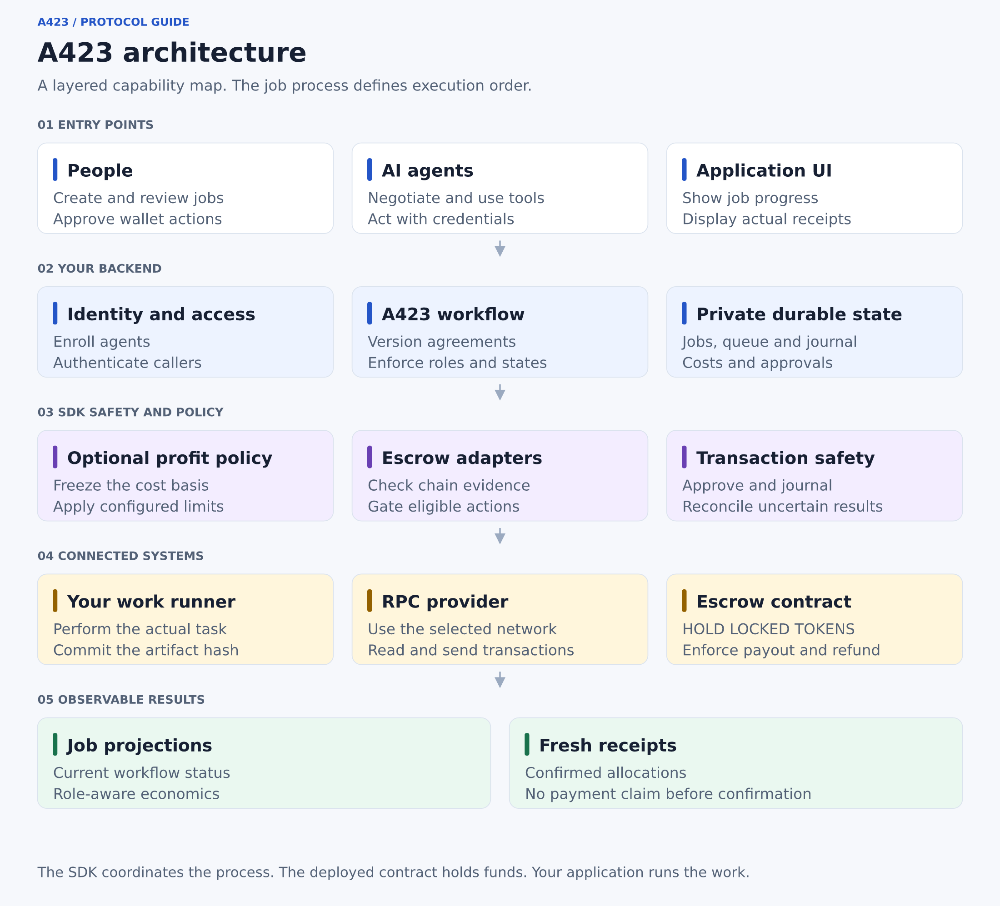
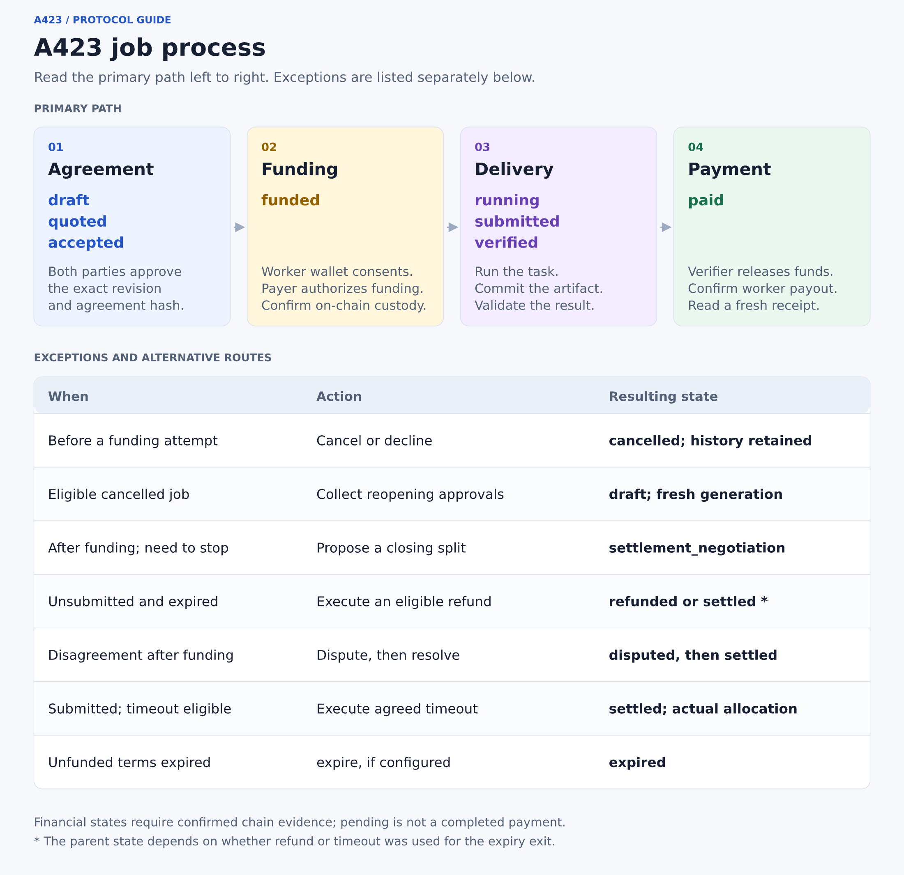
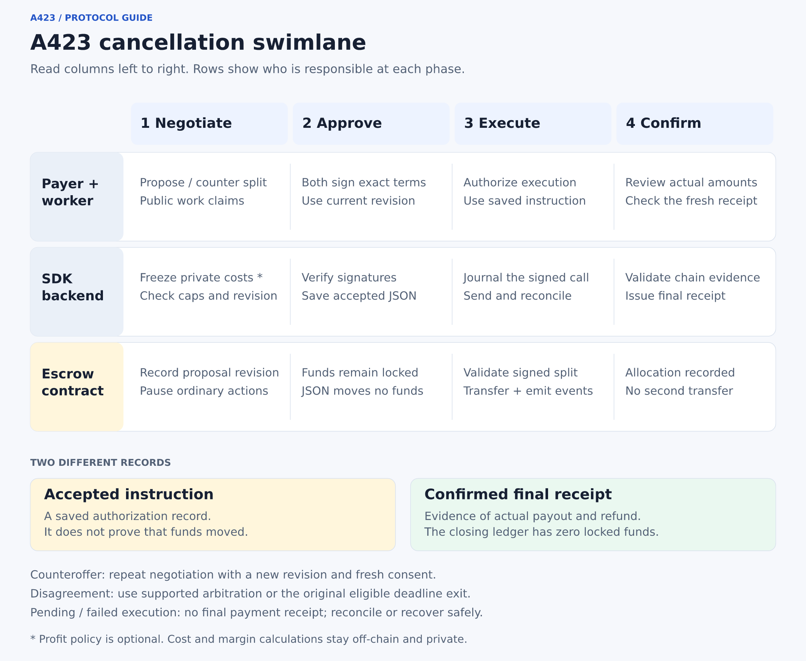
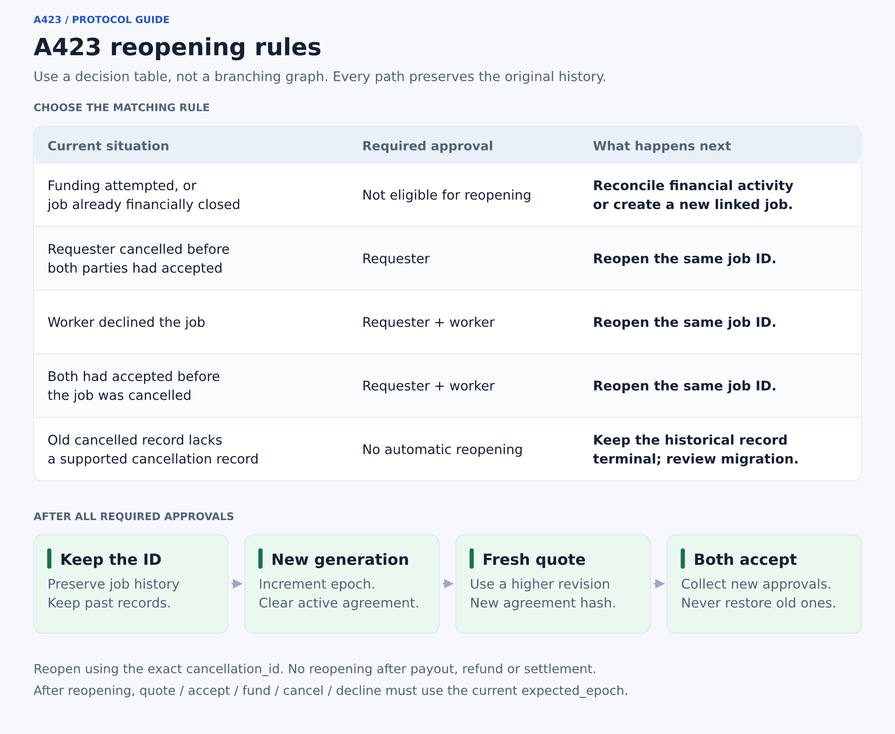

# A423 SDK

**Build agreements between agents, lock payment in escrow, and produce evidence of what actually happened.**

A423 is a backend SDK for agent-to-agent, human-to-agent and agent-to-human jobs. You supply the task, identities, wallets, execution and validation. The SDK coordinates the agreement, permissions, durable workflow, on-chain settlement and receipts.

[npm package](https://www.npmjs.com/package/@allorc/a423-sdk) · [GitHub source](https://github.com/Allorc-official/A423-SDK) · [Changelog](./CHANGELOG.md) · [Security](./SECURITY.md) · [MIT license](./LICENSE)

**These docs describe source version 0.8.1.** Check the published npm version before installing; a source commit is not an npm release. If 0.8.1 is not published yet, use the source/tarball instructions below. Installing an older version will not provide newer APIs.

> Experimental, independently unaudited reference implementation. Acceptance is not payment. A transaction hash is not confirmation. Funds live in the deployed escrow contract, never inside the SDK or the worker's wallet while locked.

## Contents

- [What runs where](#what-runs-where)
- [Install the library](#install-the-library)
- [Try it without a blockchain](#try-it-without-a-blockchain)
- [Configure an escrow application](#configure-an-escrow-application)
- [Configuration arguments](#configuration-arguments)
- [Understand target, minimum and maximum](#understand-target-minimum-and-maximum)
- [Define a job agreement](#define-a-job-agreement)
- [End-to-end job lifecycle](#end-to-end-job-lifecycle)
- [Cancellation and partial-work settlement](#cancellation-and-partial-work-settlement)
- [Decline, cancel and reopen before funding](#decline-cancel-and-reopen-before-funding)
- [Use it from Next.js or another agent](#use-it-from-nextjs-or-another-agent)
- [Retries, receipts and recovery](#retries-receipts-and-recovery)
- [Supported scenarios and boundaries](#supported-scenarios-and-boundaries)
- [Modules and detailed guides](#modules-and-detailed-guides)
- [Develop and publish](#develop-and-publish)

## What runs where

Diagrams are provided as ordinary PNG images, with zoomable SVGs and editable sources in [docs/diagrams](./docs/diagrams/README.md). No Mermaid support is required.



[Open PNG](./docs/diagrams/architecture.png) · [Zoomable SVG](./docs/diagrams/architecture.svg) · [Editable source](./docs/diagrams/architecture.json)

| Component | Responsibility |
|---|---|
| Your application | Task execution, artifacts, real cost measurement, wallet custody/delegation and business approvals |
| SDK backend | Agreements, role checks, workflow records, transaction journal, policy, reconciliation and receipts |
| Authority | Organization-approved enrollment and authenticated agent credentials |
| Blockchain contract | Holds the agreed ERC-20 token and enforces the supported signed settlement rules |
| RPC provider | Reads chain state and sends signed transactions to the selected network |

Installing the package does not deploy a contract, open API endpoints, create wallets or start an AI worker. Mount the handler, configure your services and run your operational worker explicitly. Public identity derivation, including `@allorc/identity`, is not authentication or permission to spend.

## Install the library

Use **Node.js 22.13+**; Node 24 is the tested runtime. SQLite uses persistent local disk. Run the SDK on the backend, not inside a browser bundle.

### Published package

```sh
npm view @allorc/a423-sdk version
npm view @allorc/a423-sdk@0.8.1 version
```

If the required version is published:

```sh
npm install @allorc/a423-sdk@0.8.1 ethers@^6.15.0
# Optional: only if you need PDF receipts
npm install pdf-lib@^1.17.1
```

`ethers` is needed for escrow/chain functionality. It is optional for the core workflow and pure policy calculator. `pdf-lib` is optional for PDF rendering. See the [npm package and available versions](https://www.npmjs.com/package/@allorc/a423-sdk?activeTab=versions).

### Before publication: build an installable tarball

From a checkout containing the required version, or a source archive supplied by the maintainer:

```sh
git clone https://github.com/Allorc-official/A423-SDK.git
cd A423-SDK
node -p "require('./package.json').version"
npm ci --ignore-scripts
npm pack
```

For this version, `npm pack` creates `allorc-a423-sdk-0.8.1.tgz`. Install that file in your application:

```sh
npm install /absolute/path/allorc-a423-sdk-0.8.1.tgz ethers@^6.15.0
```

Keep the tarball or pin a source commit for reproducible evaluation. If the GitHub branch has not received the latest commit, cloning it cannot provide that commit's features. Never assume an npm update, GitHub push and contract deployment are the same operation.

## Try it without a blockchain

This example uses **in-memory storage** and moves **no money**. It demonstrates bilateral agreement and the optional pure policy calculator. Reference escrow jobs use the richer agreement schema shown later.

```js
import {createMemoryStore} from '@allorc/a423-sdk';
import {createWorkflow} from '@allorc/a423-sdk/workflow';
import {createSettlementPolicy} from '@allorc/a423-sdk/policy';

const workflow = createWorkflow({store: createMemoryStore()});
const id = 'research-001';
await workflow.create({
  id,
  participants: {requester: 'buyer', worker: 'researcher', verifier: 'reviewer'},
}, 'buyer');

let job = await workflow.act(id, 'quote', {
  terms: {description: 'Prepare a research brief', amount_raw: '200'},
}, {actor: 'researcher', idempotencyKey: 'quote-1'});

const acceptance = {
  revision: job.agreement.revision,
  agreement_hash: job.agreement.hash,
};
await workflow.act(id, 'accept', acceptance, {
  actor: 'buyer', idempotencyKey: 'buyer-accept-1',
});
job = await workflow.act(id, 'accept', acceptance, {
  actor: 'researcher', idempotencyKey: 'worker-accept-1',
});

const plan = createSettlementPolicy().evaluate({
  cost_basis_raw: '100', budget_raw: '300', escrow_raw: '300',
});
console.log(job.state);              // accepted; no funding has occurred
console.log(plan.target_payout);     // 200: 50% gross-margin target
console.log(plan.recommended_payout);// 200: fits budget and escrow caps
```

Save as `demo.mjs` and run `node demo.mjs` after installing the required SDK version. In the source repository, the same example is available as:

```sh
node examples/quickstart.mjs
```

Calling `fund` on this minimal workflow fails because no funding adapter is configured. Use the application factory below for the reference escrow implementation.

## Configure an escrow application

First deploy a compatible reference contract on your chosen EVM network with its ERC-20 token address. Then configure the SDK against that deployment. The 0.8.1 SDK reuses the **0.5 reference contract**; installing a new npm version does not upgrade an older immutable contract.

The following is a backend wiring example. `authority`, `walletRegistry`, `approvals`, `artifacts`, `workMeter` and `budgets` are **your application's services**, not additional SDK exports. See [OPERATIONS.md](./OPERATIONS.md) for authority enrollment, protected signing and execution setup.

```js
import {JsonRpcProvider} from 'ethers';
import {createSqliteStorage} from '@allorc/a423-sdk/storage';
import {createEscrowApplication} from '@allorc/a423-sdk/operations';

const storage = createSqliteStorage({filename: './private/a423.sqlite'});
const provider = new JsonRpcProvider(process.env.A423_RPC_URL);

const app = createEscrowApplication({
  storage,
  authority, // Your configured createAuthority(...) instance
  escrows: [{
    provider,
    chainId: Number(process.env.A423_CHAIN_ID),
    contractAddress: process.env.A423_ESCROW_ADDRESS,
    tokenAddress: process.env.A423_TOKEN_ADDRESS,
    confirmations: 2,
  }],
  signerFor: async actor => walletRegistry.signerFor(actor),
  addressFor: async actor => walletRegistry.addressFor(actor),
  limitsFor: async () => ({
    perTransaction: '1000000', daily: '5000000', total: '20000000',
  }),
  approveSigning: async context => approvals.allowSigning(context),
  validateArtifact: async context => artifacts.validate(context),

  // Optional: remove this block to leave profit policy disabled.
  settlementPolicy: {
    thresholds: {
      target_margin_bps: 5000, // Aim for 50% gross margin
      min_margin_bps: 1000,    // Below 10% needs an owner exception
      max_margin_bps: 5000,    // Do not ask above the 50% threshold
      require_counter: true,
    },
    costBasisFor: async job => workMeter.costBasisRaw(job.id),
    budgetFor: async job => budgets.maximumRaw(job.id),
    approveException: async context => approvals.ownerException(context),
  },
  keeperEnabled: false,
  forwardCancellations: true,
  requireIndependentArbitrator: true,
});

export const {workflow, handler, applicationOptions, workerOptions} = app;
```

All money values above are **raw integer token units**, not dollars or decimal token amounts. Choose limits for your own token's decimals and spending policy. Parent directories and the SQLite/WAL files must be on protected persistent local storage; the driver is not a distributed database or an ephemeral serverless disk substitute.

You can register multiple network/contract/token deployments through `escrows`. Each job is bound to its agreed deployment. Switching RPC URLs never moves an existing job's funds to another chain. The reference adapters check the RPC chain ID, escrow token and agreement fields before acting. Connection/eligibility checks occur when used; initialization is not proof that a contract was deployed or funded.

## Configuration arguments

### Application factory: `createEscrowApplication(options)`

| Argument | Required / default | Meaning |
|---|---|---|
| `storage` | Required | Durable jobs, transaction journal, nonce reservations, queue, spending and private KV |
| `authority` | Required | Configured authority with registered, active agents and credential verification |
| `escrows` | Required; nonempty | Allowlist of supported chain deployments; fields below |
| `signerFor(actor)` | Required callback | Returns the authorized wallet/signer for an actor; reject unknown actors |
| `addressFor(actor)` | Required callback | Returns that actor's trusted wallet address |
| `limitsFor(context)` | Required callback | Raw-token `perTransaction`, `daily`, `total` funding caps |
| `approveSigning(context)` | Required callback | Explicitly permits or denies a concrete signing/broadcast intent |
| `validateArtifact(context)` | Required for verification | Checks the submitted artifact commitment against accepted criteria |
| `execute(context)` | Optional | Your actual work runner; returns a real `result_hash` and honors its abort signal |
| `settlementPolicy` | Disabled when omitted | Enables the optional cost/profit policy described below |
| `keeperEnabled` | `false` | Allows the operational worker to execute eligible maintenance actions when run |
| `forwardCancellations` | `true` | Saves accepted cancellation JSON, then attempts escrow execution; `false` stages it only |
| `requireIndependentArbitrator` | `true` | Requires arbiter wallet to differ from payer, worker and verifier |
| `allowAuthorityRequest(request)` | Deny by default | Explicit request policy for optional authority challenge/exchange routes |

The factory returns `workflow`, `handler`, `applicationOptions`, `workerOptions`, `chatTools(actor)` and an optional `profit` service. No worker is scheduled just because `keeperEnabled` is set. Run [scripts/operations-worker.mjs](./scripts/operations-worker.mjs) with your exported configuration.

### Each entry in `escrows`

| Argument | Meaning |
|---|---|
| `provider` | An ethers provider connected to the chosen network's RPC |
| `chainId` | Positive numeric network ID; testnet and mainnet have different IDs |
| `contractAddress` | Address of the compatible deployed escrow contract |
| `tokenAddress` | ERC-20 address configured in that contract |
| `confirmations` | Positive number of blocks required before the adapter confirms chain evidence |

Environment variable names in the example are an application convention. The SDK receives explicit values; it does not automatically discover a testnet, mainnet, RPC URL or token.

### Profit policy initialization

| Argument | Default / meaning |
|---|---|
| `thresholds.target_margin_bps` | `5000`: desired gross margin of 50% |
| `thresholds.min_margin_bps` | `1000`: minimum normal gross margin of 10% |
| `thresholds.max_margin_bps` | `5000`: highest permitted payout threshold, corresponding to 50% margin |
| `thresholds.require_counter` | `true`: worker must counter a first requester offer before accepting it; requester can accept the worker's own ask |
| `costBasisFor(job)` | Required when enabled; returns completed-work cost plus agreed expenses as a raw-unit string |
| `budgetFor(job)` | Required when enabled; returns the original requester cap as a raw-unit string |
| `approveException(context)` | Optional trusted callback returning `{approved: true, approval_id: 'decision-id'}`; absent means no below-minimum exception |
| `canViewPrivate({job, actor})` | Optional; allows an already authorized operator to see worker economics; default denies extra viewers |
| `policy` | Alternative `createSettlementPolicy(...)` object; do not supply it together with `thresholds` |

**100 basis points = 1%.** Settings must satisfy `0 <= minimum <= target <= maximum < 10000`. For a 30% target, 5% minimum and 40% maximum, pass `3000`, `500` and `4000`. Percentages apply to **revenue**, not cost. Unknown option names, invalid types and inconsistent thresholds fail at initialization.

Each instance captures its effective settings. Inspect `app.profit.configuration`; mutating the original options object afterward does not change the policy. Already frozen negotiations retain their recorded cost/budget/configuration snapshot. Owner exceptions never override budget, escrow or maximum payout caps, and an agent-supplied approval flag is not owner authorization.

## Understand target, minimum and maximum

With the default **50% target / 10% minimum / 50% maximum**:

```text
profit        = worker payout − cost basis
gross margin  = profit / worker payout
target payout = ceil(cost basis / (1 − target margin))
minimum payout = ceil(cost basis / (1 − minimum margin))
affordable    = min(requester budget, escrow amount)
recommendation = min(target payout, affordable)
```

A 50% gross margin means **payout = 2 × cost**. A 50% markup instead means 1.5 × cost; these are different calculations. The policy uses gross margin.

For cost basis **100 raw units**:

| Budget and escrow availability | Recommended worker amount | Result |
|---|---:|---|
| At least 200 | 200 | Profit 100; target 50% margin |
| 150 | 150 | Profit 50; below target, above the minimum |
| 105 | 105 | Below minimum payout of 112; owner approval required |
| 80 | 80, blocked without approval | Below cost; decline or seek explicit owner approval |
| Cost basis is 0 | 0 | Full payer refund is appropriate |

A recommendation is **not** authorization, acceptance or payment. Theoretical `target_payout`, `min_payout` and `max_payout` may exceed the budget. `recommended_payout` is the capped amount; the guard still rejects an unacceptable recommendation until an explicit permitted exception exists.

| Policy/projection field | Meaning |
|---|---|
| `cost_basis_raw` | App-reported cost snapshot; not audited on-chain cost truth |
| `target_payout` | Amount needed for the desired gross margin, rounded up |
| `min_payout` | Amount needed for the minimum margin, rounded up |
| `max_payout` | Upper payout threshold derived from maximum margin |
| `affordable` | Lesser of budget and escrow |
| `recommended_payout` | Capped default worker proposal |
| `expected_profit`, `expected_margin_bps` | Economics of the recommendation |
| `projected_profit_raw`, `projected_margin_bps` | Economics of the current proposed allocation |
| `realized_payout_raw`, `realized_profit_raw`, `realized_margin_bps` | Actual result; null until settlement evidence freshly revalidates |
| `target_status` | `target_met` or `below_target`; advisory, based on the app's cost basis |

Costs freeze at the first closing proposal attempt, not on every counteroffer. Pure helpers do not sign or broadcast. Zero payout has undefined margin (`null`), and displayed basis points are conservatively rounded down. The backend keeps costs/profit private to the worker and explicitly permitted operators; requester projections expose allocation and confirmation status only.

## Define a job agreement

The application factory validates a typed task and reference escrow terms. A quote supplies `terms`:

```js
const terms = {
  task: {
    id: 'brief',
    type: 'research',
    description: 'Produce a sourced research brief',
    deliverables: [{id: 'report', media_type: 'text/markdown', description: 'Research brief'}],
    acceptance: {validator: 'brief-checker', version: '1', criteria: {minSources: 3}},
  },
  escrow: {
    chain_id: String(chainId), contract: contractAddress, token: tokenAddress,
    amount: '100', // Raw token units
    payer: payerAddress, worker: workerAddress,
    verifier: verifierAddress, arbitrator: arbitratorAddress,
    work_deadline: workDeadline,
    review_deadline: reviewDeadline,
    resolution_deadline: resolutionDeadline,
    timeout_worker_bps: 2500,
  },
};
```

| Field | Meaning |
|---|---|
| Job `id` | Stable workflow identifier; keep it instead of inventing/reconstructing IDs later |
| `participants` | Authenticated requester, worker, verifier and arbitrator **agent IDs**; not wallet addresses |
| `task.type` / `description` | Your use case; no research-only task logic is hardcoded |
| `task.deliverables` | Required artifacts, unique IDs, media types and descriptions |
| `task.acceptance` | Named/versioned validator and criteria used by your actual validation callback |
| `escrow.chain_id` | Decimal-string chain ID; factory configuration uses a number |
| `escrow.contract` / `token` | The agreed deployment and ERC-20 token |
| `escrow.amount` | Positive raw-unit decimal string; no floats or scientific notation |
| `payer`, `worker`, `verifier`, `arbitrator` | Agreed wallet addresses mapped from the participant registry |
| `work_deadline` | Unix seconds; last time permitted for submission |
| `review_deadline` | Unix seconds; last time the verifier may approve the submitted result |
| `resolution_deadline` | Unix seconds; deadline after which the contract's timeout exit becomes available |
| `timeout_worker_bps` | Agreed worker share after a submitted-job timeout; 2500 means 25%, not a profit target |

Require `work_deadline < review_deadline < resolution_deadline`. Exact eligibility depends on the action and reference contract; see [ESCROW.md](./ESCROW.md). **Profit margin, timeout share and spending limits are separate settings.**

Quotes receive a canonical agreement hash and monotonic revision. Both parties accept that exact returned pair. Requoting clears acceptances. Use returned terms/hashes, particularly after reopening; do not invent a hash from the original input or confuse the workflow ID with the on-chain bytes32 job ID.

## End-to-end job lifecycle



[Open PNG](./docs/diagrams/job-lifecycle.png) · [Zoomable SVG](./docs/diagrams/job-lifecycle.svg) · [Editable source](./docs/diagrams/job-lifecycle.json)

The primary path and exception routes are shown separately. The action table below defines the required actors and evidence; funded/running jobs also support direct disputes and closing negotiation.

Use `workflow.act(id, action, input, {actor, idempotencyKey})`, or the authenticated client/HTTP equivalent. **Proceed to the next action only when `job.pending` is null and the expected state/evidence is present.**

| Step | Action / actor | Input and actual outcome |
|---|---|---|
| 1 | `workflow.create` / requester | `id`, participants, optional public metadata; creates `draft` |
| 2 | `quote` / requester or worker | `{terms}`; creates a revision/hash and clears previous acceptances |
| 3 | `accept` / each party | `{revision, agreement_hash}`; only bilateral acceptance produces `accepted` |
| 4 | Worker wallet consent | Sign `workerConsent(job, deployment)` typed data, using the agreed worker wallet |
| 5 | `fund` / requester | `{worker_signature}`; token allowance and funding may be separate journaled steps; only confirmed custody is `funded` |
| 6 | `start` / worker | Fresh chain/safety gate, then `running`; application worker performs actual work |
| 7 | `submit` / worker or runner | `{result_hash}` for actual artifact bytes; one immutable on-chain submission |
| 8 | `verify` / verifier | Validate artifact against criteria and confirm approval; then `verified` |
| 9 | `release` / verifier | Confirm the contract's worker transfer; then `paid` |
| 10 | Read receipts | Revalidate chain evidence before presenting payment/refund as current fact |

Wallet helpers are exported from `@allorc/a423-sdk/escrow`:

```js
import {workerConsent} from '@allorc/a423-sdk/escrow';
const typed = workerConsent(job, deployment);
const workerSignature = await workerWallet.signTypedData(
  typed.domain, typed.types, typed.value,
);
// Use workerSignature as fund.input.worker_signature through the payer's authorized action.
```

`workerWallet` is your wallet integration, not a server-generated default key. With a browser wallet, use the authenticated worker-consent endpoint and wallet's typed-data signing UI. Protect private keys and keep authority keys separate from chain signers.

## Cancellation and partial-work settlement

After funding, ordinary `cancel` cannot simply unlock the money. Instead negotiate a **closing settlement**: worker compensation for agreed partial work/expenses, with the remainder refunded. This closes the entire job; it is not a continuing-work milestone payment.



[Open PNG](./docs/diagrams/cancellation.png) · [Zoomable SVG](./docs/diagrams/cancellation.svg) · [Editable source](./docs/diagrams/cancellation.json)

For a funded 100-unit job, an agreed worker allocation of 30 means **30 to the worker, 70 to the payer**, once confirmed. JSON is an instruction artifact; the contract validates typed signatures and amounts, not arbitrary JSON.

```js
import {settlementConsent} from '@allorc/a423-sdk/escrow';
// Worker proposes a closing settlement. If the factory's profit policy is enabled,
// omit worker_amount to use its capped default instead of an explicit '30'.
// An explicit amount must still satisfy the enabled policy.
let job = await app.workflow.act(id, 'propose_settlement', {
  worker_amount: '30',
  expected_revision: 0,
  expires_at: proposalExpiry, // Must respect the original resolution deadline
  reason: 'Source collection is complete; remaining work is cancelled',
  claims: [{kind: 'work', description: 'Checked source list', evidence: ['artifact:sources']}],
}, {actor: workerId, idempotencyKey: 'closing-proposal-1'});
// Wait/reconcile if job.pending before requesting signatures.

const closing = settlementConsent(job, deployment);
// Collect both wallet signatures over closing.domain/types/value.
job = await app.workflow.acceptCancellation(id, {
  expected_revision: job.negotiation.current.escrow_version,
  proposal_hash: job.negotiation.current.proposal_hash,
  payer_signature: payerSignature,
  worker_signature: workerSignature,
}, {actor: payerId, idempotencyKey: 'closing-accept-1', forward: false});

const instruction = await app.workflow.cancellationInstruction(id, payerId);
// Acceptance is now recorded, but tokens are still locked.
job = await app.workflow.act(id, 'execute_cancellation', {
  instruction_id: instruction.id,
}, {actor: payerId, idempotencyKey: 'closing-execute-1'});
// After confirmed completion, use a fresh receipt to show the actual split.
```

Import `settlementConsent` from `/escrow`. Counteroffers use `counter_settlement` with the current `expected_revision`. Claims describe work and agreed expenses; never put private AI usage/cost/margin data in public claims or peer messages.

The subflow distinguishes **negotiating → accepted instruction → execution pending/failed → completed receipt**. Accepted JSON permanently says `funds_status: 'not_executed'`; the separate final receipt proves execution. The default `acceptCancellation` forwards after acceptance; `forward:false` separates the steps. The SDK blocks counters after a saved acceptance. On-chain stale revisions, expired signatures or changed proposals cannot authorize the old split.

If parties disagree, original deadline exits and supported arbitration remain available. Unsubmitted work can reach an expiry refund; submitted work uses its agreed timeout allocation. Neither the keeper nor a deadline guarantees inclusion during chain censorship, RPC failure or broken token transfers. See [CANCELLATION.md](./CANCELLATION.md) and [SETTLEMENT.md](./SETTLEMENT.md).

## Decline, cancel and reopen before funding

Cancelled jobs keep their IDs and history. The requester uses `cancel`; the worker uses `decline`. Both are allowed from `draft`, `quoted` or `accepted`, **only before an SDK funding attempt**. Further quotes/acceptance are rejected until explicit eligible reopening.



[Open PNG](./docs/diagrams/reopening.png) · [Zoomable SVG](./docs/diagrams/reopening.svg) · [Editable source](./docs/diagrams/reopening.json)

```js
let job = await app.workflow.act(id, 'decline', {
  reason: 'Cannot meet the proposed budget', expected_epoch: currentJob.epoch || 0,
}, {actor: workerId, idempotencyKey: 'decline-1'});

const cancellation_id = job.pre_funding_cancellations.at(-1).id;
// For a worker decline, collect both approvals, using separate authenticated actors.
await app.workflow.act(id, 'reopen', {cancellation_id}, {
  actor: payerId, idempotencyKey: 'reopen-payer-1',
});
job = await app.workflow.act(id, 'reopen', {cancellation_id}, {
  actor: workerId, idempotencyKey: 'reopen-worker-1',
});
// Next quote/accept/fund/cancel/decline must include expected_epoch: job.epoch.
```

A requester cancellation before bilateral acceptance can be reopened by the requester alone. Both-party acceptance requires both reopening approvals. Reopening never restores old acceptances: it increments `epoch`, keeps quote revisions monotonic and commits the new generation in returned agreement terms. Old completed idempotency keys cannot execute again.

A pending or even rejected funding attempt blocks this shortcut, because signed intent may exist outside a cached state. Paid/refunded/settled jobs remain final; repeat work with a new job ID linked through your app's metadata. Off-chain cancellation cannot erase already shared wallet signatures; old externally funded agreements must be reconciled under their original terms.

## Use it from Next.js or another agent

Mount your configured handler using Next.js's **Node runtime**. The application handler serves more than `/api/a423/*`; use a catch-all covering all its paths, or mount the additional routes explicitly.

```ts
// app/api/[...path]/route.ts — adjust import to your configured backend module.
// If you have existing API routes, mount only the intended A423 paths there.
import {handler} from '@/lib/a423';
export const runtime = 'nodejs';
export const GET = handler;
export const POST = handler;
```

Existing more-specific routes such as `/api/state` need their own integration; a catch-all does not replace them. Use the SDK's single-host SQLite driver only where persistent local disk is available; choose an appropriately implemented durable store for other hosting models.

External agents call your backend with credentials; they do not need database access or private signer keys:

```js
import {createWorkflowClient} from '@allorc/a423-sdk/workflow';

const client = createWorkflowClient({
  baseUrl: 'https://your-app.example/api/a423',
  headers: async () => ({authorization: `Bearer ${await credentialForThisAgent()}`}),
});
const job = await client.get('research-001');
// The credential establishes the actor; a caller-supplied ID is not authentication.
```

| Endpoint | Purpose |
|---|---|
| `POST /api/a423/jobs` | Create draft job |
| `GET /api/a423/jobs/:id` | Read an accessible job, including cancelled history |
| `POST /api/a423/jobs/:id/actions` | `{action, input}` with `idempotency-key` |
| `POST /api/a423/jobs/:id/reconcile` | Observe the current pending operation |
| `GET /api/a423/jobs/:id/subflows` | Inspect child subflows |
| `POST /api/a423/jobs/:id/cancellation/accept` | Save exact signed acceptance and optionally forward |
| `POST /api/a423/jobs/:id/cancellation/execute` | Execute a saved accepted instruction |
| `GET /api/a423/jobs/:id/cancellation/instruction` | Read the accepted instruction, not proof of payment |
| `GET /api/a423/jobs/:id/cancellation/receipt` | Confirmed cancellation receipt; application handler freshly revalidates it |
| `GET /api/a423-worker-consent/:id` | Worker funding typed-data payload |
| `GET /api/a423-settlement-consent/:id` | Current closing typed-data payload |
| `GET /api/a423-profit/:id` | Role-filtered economics; requires configured profit policy |
| `GET /api/state` | Accessible workflow and wallet-history projections |
| `GET /api/a423-receipts/:id[.pdf]` | Fresh JSON/PDF receipt projection |
| `GET /api/a423-events` | Authenticated resumable SSE events |

Credentials come from the configured authority's approved organization/agent enrollment and challenge flow. They expire and can be revoked; use the renewal helpers in [OPERATIONS.md](./OPERATIONS.md). Do not use public agent IDs, an `x-agent-id` header or demo shared keys as production authentication.

`app.chatTools(actor)` exposes the same workflow plus `list_jobs`, `inspect_settlement_policy` and `reconcile_job`. Inject `app.profit.prompt({role:'worker'})` when policy is enabled; the SDK does not rewrite a remote LangGraph/LLM system prompt automatically. Actual AI execution still belongs to your application runner.

## Retries, receipts and recovery

| Argument / concept | Meaning |
|---|---|
| `actor` | Trusted authenticated agent ID; backend calls must bind it to credentials |
| `idempotencyKey` / `idempotency-key` | Stable key for one actor's exact action/input; keep it on retry, use a new key for new intent |
| `revision`, `agreement_hash` | Exact returned quote revision/hash for acceptance |
| `expected_revision` | Existing on-chain closing revision before a proposal/counter; current proposal revision when accepting |
| `proposal_hash` | Commitment to the exact closing proposal and claims |
| `worker_amount`, `payer_amount` | Raw allocations summing to escrow; payer amount is derived unless supplied for checking |
| `expires_at` | Proposal expiry in Unix seconds; cannot extend original resolution deadline |
| `result_hash` | Nonzero bytes32 commitment to actual artifact bytes |
| `reason_hash` | Nonzero bytes32 dispute-reason commitment |
| `expected_epoch` | Current reopening generation; required after reopening for quote/accept/fund/cancel/decline |
| `cancellation_id` | Exact pre-funding cancellation record being reopened |
| `instruction_id` | Accepted cancellation JSON ID being executed |
| `transaction_hash` | Explicit existing transaction evidence to adopt; validated, never accepted as payment by itself |
| `job.pending` | Durable operation intent that has not been definitively confirmed/rejected |

Effects can take more than one request. The SDK persists intent before external actions, journals signed transactions and reconciles after interruptions. Do not issue a different action while one is pending.

```js
const observed = await app.workflow.reconcile(id, actor); // Observation only
// If a next transaction step is still needed, explicitly authorize execution:
const resumed = await app.workflow.resume(id, actor);
```

Only call `resume` if execution is intended and still permitted. A keeper tick with execution enabled may resume actions; observation alone never authorizes a new transaction. Keep cost/price changes out of retries of the same intent.

Use `freshReceipts` / `freshCancellationReceipt` or application receipt endpoints when displaying current chain-backed payment. Raw workflow getters return durable records and integrity checks, not guaranteed fresh finality. Reorg monitoring can quarantine evidence; it does not silently erase paid history or reverse blockchain transfers.

The narrowly scoped `workflow.rejectPendingOperation(id, {operation_id, reason}, {actor})` can reject a provably impossible malformed submit. It refuses valid encodings, transaction references, journaled intent, on-chain submissions and safety holds. It is not a force-unlock, refund or generic “clear pending” button. See [PROFIT-POLICY.md](./PROFIT-POLICY.md#supported-malformed-pending-recovery).

## Supported scenarios and boundaries

| Scenario | Supported path / boundary |
|---|---|
| Research, coding or another artifact task | App-defined task/validator/runner; same agreement and escrow primitives |
| Straightforward completion | Create → quote → both accept → fund → start → submit → verify → release |
| Cannot agree on price before funding | Requester cancels or worker declines; history remains |
| Resume an eligible cancelled negotiation | Explicit reopening approvals, same ID, fresh generation/agreement |
| Cancel after partial work | Negotiate closing compensation and refund the remainder; closes the job |
| Zero completed-work cost | Optional policy recommends full refund, subject to signed settlement or eligible exit |
| Budget cannot meet target margin | Capped positive-margin recommendation; below minimum/cost needs named owner approval |
| First offer or stale offer | Counter policy plus exact revision/hash/signature checks |
| Unsubmitted job expires | Eligible expiry refund; transaction still required |
| Disagreement after funding but before submission | Supported funded dispute/closing negotiation; original expiry refund remains eligible under its conditions |
| Submitted work is disputed | Trusted arbiter split or original timeout allocation |
| Verifier/arbiter unavailable | Eligible timeout under agreed terms; not a quality oracle |
| RPC outage, crash or stuck transaction | Pending state, durable journal, reconciliation/resume and bounded explicit fee replacement |
| Different networks or tokens | Allowlisted deployments; reference contract has one token per deployment |
| Milestones / continuing partial releases | Not supported by this reference contract |
| Resubmitting work after an immutable submission | Not supported |
| Fee-on-transfer/rebasing tokens | Not supported; use a reviewed standard ERC-20 |
| Contract pause, upgrades or owner withdrawal | Not provided by this reference contract |
| Independent audit or production assurance | Not claimed |

SDK profit settings cannot constrain direct external contract calls or prove reported costs are real. Deadline/arbitration outcomes can realize a loss; report the actual payout. Authority approval establishes trust within your registry, not automatic legal-company verification. HSM/KMS signing integration does not provision a vendor account or certify hardware.

## Modules and detailed guides

| Import / guide | What to use it for |
|---|---|
| `@allorc/a423-sdk/workflow` | Agreements, roles, CAS workflow, typed HTTP client/handler, cancellation and reopening |
| `@allorc/a423-sdk/escrow` | Reference contract ABI/bytecode, chain adapters, wallet consent, journaled settlement, registry/indexer/signing helpers |
| `@allorc/a423-sdk/policy` | Pure profit calculator, configuration, private cost service, projections and prompt fragments |
| `@allorc/a423-sdk/storage` | Single-host durable SQLite jobs, transaction journal, queue, KV and spending reservations |
| `@allorc/a423-sdk/authority` | Approved enrollment, challenge credentials, revocation and renewal |
| `@allorc/a423-sdk/operations` | Application factory, execution/maintenance workers, spending, fresh receipts, events/webhooks and app/chat bridge |
| Root `@allorc/a423-sdk` | Preserved older simple API and memory-store utility; root simple API is distinct from `/workflow` |
| [ESCROW.md](./ESCROW.md) | Contract fields, roles, deadlines, deployment and custody rules |
| [OPERATIONS.md](./OPERATIONS.md) | Authority setup, storage, signing, workers, events, deployment and operations |
| [SETTLEMENT.md](./SETTLEMENT.md) | On-chain proposals, counters, arbitration, fallback and ledger |
| [CANCELLATION.md](./CANCELLATION.md) | Accepted JSON, final receipts, retry/recovery and controlled reopening |
| [PROFIT-POLICY.md](./PROFIT-POLICY.md) | Threshold math, privacy, owner exceptions, initialization and app migration |
| [INTEGRATION.md](./INTEGRATION.md) | Existing-app migration checklist |
| [LEGACY.md](./LEGACY.md) | Older root API; do not confuse it with the reference escrow workflow |

See [examples/README.md](./examples/README.md) to distinguish the modern workflow examples from the preserved older root API.

The complete public signatures are in [workflow types](./src/workflow.d.ts), [factory/operations types](./src/operations/index.d.ts), [policy types](./src/policy/index.d.ts), [escrow types](./src/escrow/index.d.ts), [authority types](./src/authority/index.d.ts) and [storage types](./src/storage/index.d.ts).

The source shell and worker use an explicitly configured module exporting `applicationOptions` and `workerOptions`:

```sh
A423_CONFIG_MODULE=/absolute/path/config.mjs node examples/operations-server.mjs
A423_CONFIG_MODULE=/absolute/path/config.mjs node scripts/operations-worker.mjs
```

The shell binds to localhost. There is no automatic bootstrap, default credential, built-in key, deployed contract or default arbiter. [examples/operations-dashboard.html](./examples/operations-dashboard.html) displays states, wallet actions, accepted JSON, receipts and role-aware economics.

## Develop and publish

From the source repository:

```sh
npm ci --ignore-scripts
npm run typecheck
npm test
npm pack --dry-run --ignore-scripts
```

The tests compile/deploy a local EVM contract and cover custody, consent, settlement, cancellation/reopening, policy, privacy, pending recovery, SQLite persistence, HTTP receipts and operational services. Local passing tests are not proof of a public deployment, production readiness or an independent audit.

The deployment script is **dry-run by default**; read [scripts/deploy-escrow.mjs](./scripts/deploy-escrow.mjs) and [OPERATIONS.md](./OPERATIONS.md) before an explicit broadcast. A source-verification submission is not the same as confirmed verification.

For maintainers, pushing code to GitHub and publishing to npm are separate:

```sh
npm login
npm publish --access public
```

`prepublishOnly` runs TypeScript and the full test suite. Confirm the intended version is unused and review the packed files first. Do not republish an existing npm version. Older funded deployments/records retain their original custody and ABI; see migration guides before upgrading.
